# CYPHER — DevOps Documentation

> All screenshots are in [`docs/screenshots/`](docs/screenshots/). Sensitive values (AWS account ID) are redacted.

## 1. Project Overview & Technology Stack

**CYPHER** is a Flask web application that classifies URLs as *phishing* or *legitimate* using lexical feature extraction and a Random Forest model, with a live statistics dashboard.

| Layer | Technology |
|---|---|
| Application | Python 3.12, Flask, scikit-learn, tldextract, Chart.js |
| App server | Gunicorn (inside Docker) |
| Version control | Git, GitHub (`main`, `develop`, feature branches + pull requests) |
| Containerization | Docker (`python:3.12-slim`, non-root user, built-in HEALTHCHECK) |
| CI/CD | Jenkins (declarative `Jenkinsfile`, GitHub webhook trigger) |
| Registry | AWS ECR (`cypher` repository, lifecycle policy keeps 10 images) |
| Hosting | AWS EC2 (Ubuntu 24.04) running Jenkins + the app container |
| CDN / HTTPS | AWS CloudFront (`https://dxxxxxxxx.cloudfront.net`) |
| Access control | IAM instance role (no access keys stored), Jenkins credentials store |

**Live application (EC2):** http://54.152.241.119/index (Elastic IP)  
**CloudFront URL:** pending AWS account verification — see [Section 7](#7-cloudfront-configuration)

| Item | Value |
|---|---|
| Repository | https://github.com/Devansh42-cyber/CYPHER |
| AWS region | us-east-1 (N. Virginia) |
| Jenkins | http://54.152.241.119:8080 (job `cypher-pipeline`) |

## 2. DevOps Architecture

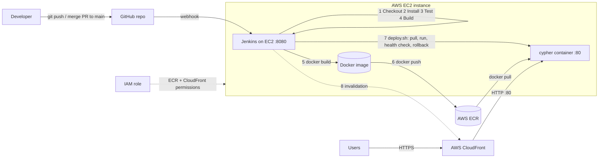

## 3. Git Repository Structure & Workflow

```
CYPHER/
├── cypher/            # Flask app, model, templates, static assets, tests
├── deploy/            # setup-ec2.sh, deploy.sh, rollback.sh, aws/ policies
├── Dockerfile  .dockerignore  .gitignore  .env.example
├── Jenkinsfile
├── README.md  DEVOPS.md
```

- **Branches:** `main` (production, deployed by Jenkins), `develop` (integration), `feature/*` (individual changes).
- **Flow:** `feature/x` → PR into `develop` → PR `develop` → `main` → webhook → pipeline → deploy.
- **Secrets:** `.gitignore` blocks `.env`, keys (`*.pem`, `*.key`, `id_rsa*`), AWS credentials and local databases. A local SQLite file (`instance/app.db`) and `__pycache__` were removed from tracking. Runtime configuration comes from environment variables (see `.env.example`).

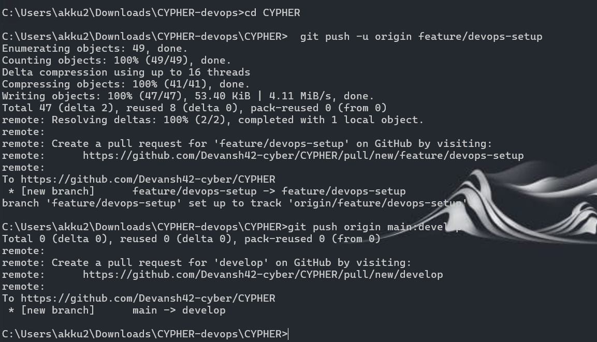
*Figure: Pushing the feature branch and creating the develop branch*

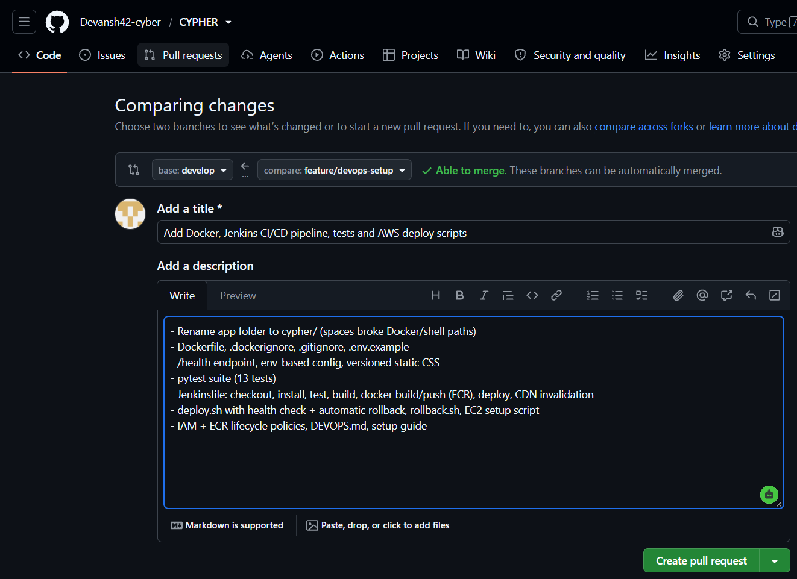
*Figure: Opening a pull request from feature/devops-setup into develop*

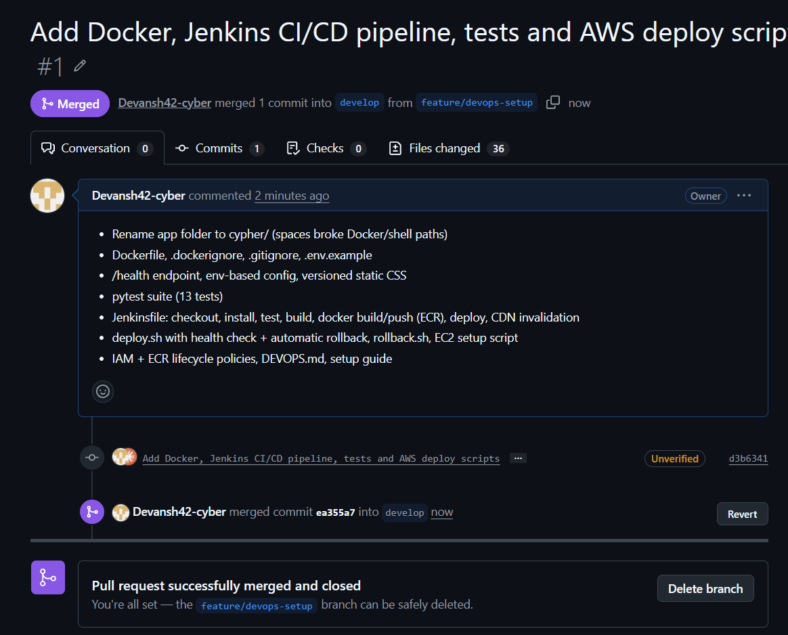
*Figure: PR #1 merged into develop*

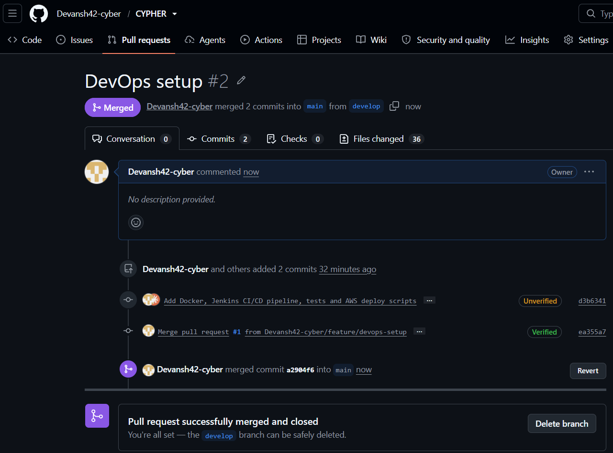
*Figure: PR #2 merged from develop into main*

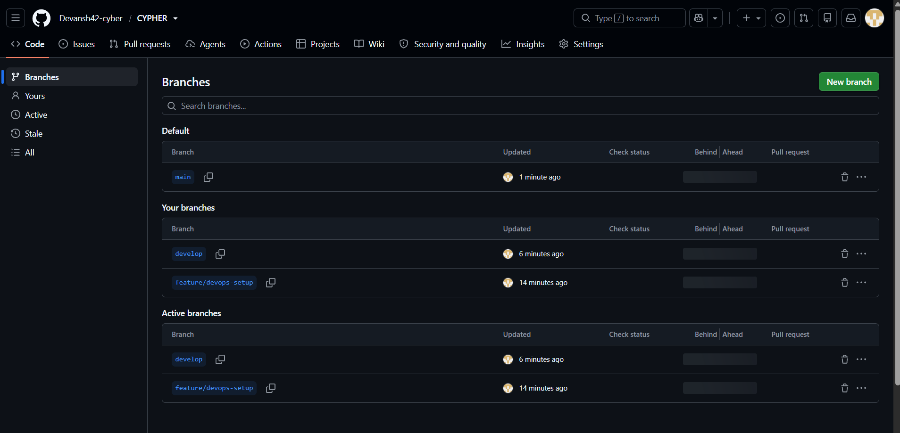
*Figure: Branches: main, develop and feature branches*

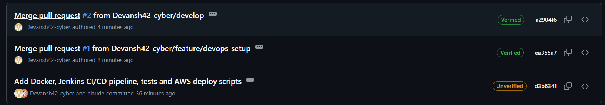
*Figure: Commit history with merge commits*

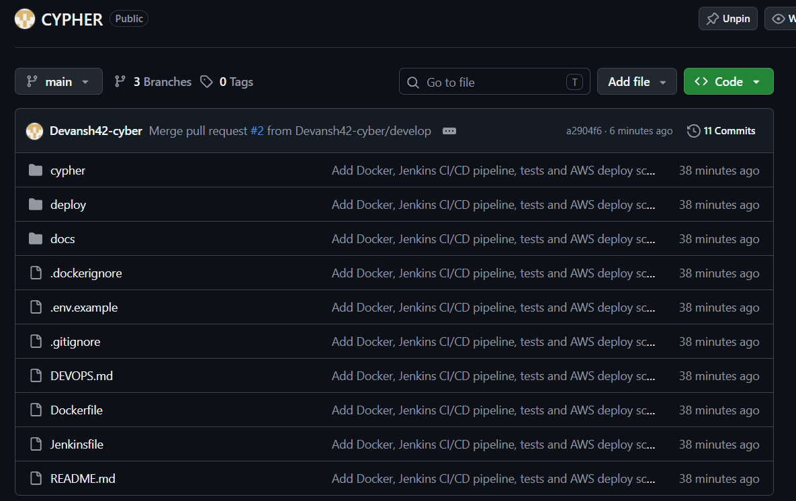
*Figure: Repository with Dockerfile, Jenkinsfile, DEVOPS.md and .gitignore*

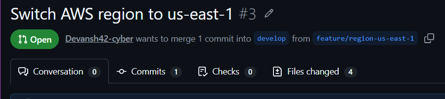
*Figure: PR #3: region change from a feature branch into develop*

## 4. Docker

**Dockerfile highlights:** slim Python base image; dependencies installed in a separate cached layer; build-time check that the ML model loads; runs as non-root `appuser`; exposes port 5000; `HEALTHCHECK` calls `/health`; served by Gunicorn.

```bash
# Build
docker build -t cypher .

# Run (configuration through environment variables)
docker run -d --name cypher -p 5000:5000 \
  -e APP_ENV=development -e APP_VERSION=local cypher

# Verify
curl http://localhost:5000/health
docker ps            # STATUS shows (healthy)
```

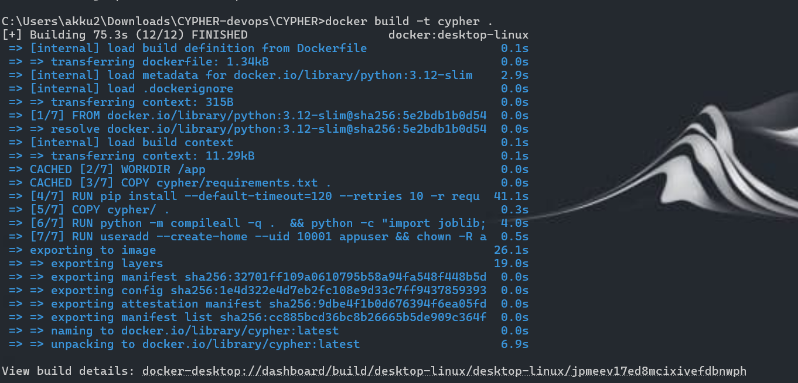
*Figure: docker build completed successfully (local machine)*

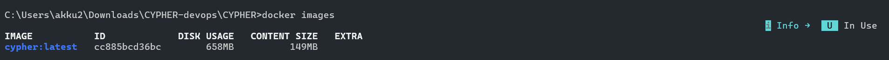
*Figure: docker images showing cypher:latest*

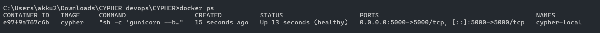
*Figure: Container running and reported healthy*

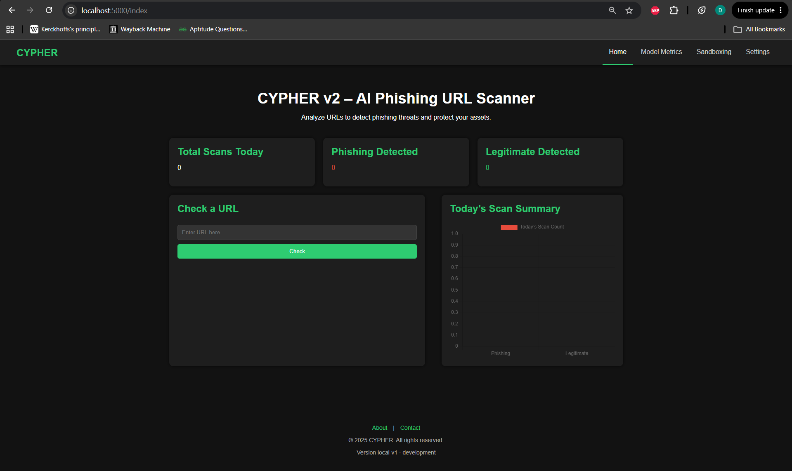
*Figure: Application running locally through Docker (localhost:5000)*

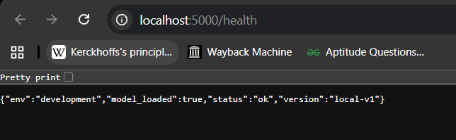
*Figure: Health endpoint showing configuration passed via environment variables*

## 5. Jenkins Pipeline

Job type: **Pipeline from SCM**, branch `*/main`, trigger **GitHub hook trigger for GITScm polling**. Webhook: `http://<EC2-DNS>:8080/github-webhook/`.

| Stage | What it does |
|---|---|
| Checkout | Pulls the commit that triggered the build; image tag = `<build#>-<git sha>` |
| Install | Creates a virtualenv and installs `requirements-dev.txt` |
| Test | Runs 13 pytest tests (features, pages, API, health); JUnit report published; **any failure stops the pipeline** |
| Build | Byte-compiles the app and verifies the model loads |
| Docker Build | `docker build -t cypher:<tag> .` |
| Docker Push | Logs in to ECR via the instance IAM role and pushes `<tag>` and `latest` |
| Deploy to EC2 | `deploy/deploy.sh` pulls the image, starts it with `--restart unless-stopped`, health-checks `/health`, rolls back automatically on failure |
| Invalidate CDN | Creates a CloudFront invalidation for `/*` (when the distribution ID is set) |

**Credentials:** AWS access uses the EC2 **IAM role** (`deploy/aws/iam-policy.json`) — no access keys exist in Jenkins or Git. The AWS account ID is stored as a Jenkins *Secret text* credential (`aws-account-id`).

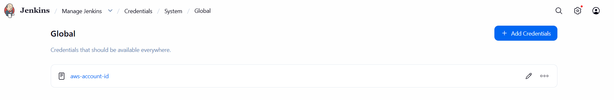
*Figure: Jenkins credential aws-account-id (value hidden)*

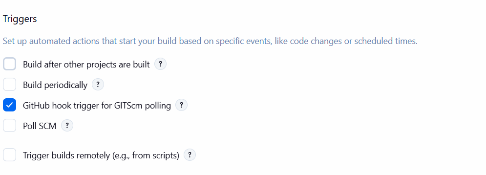
*Figure: GitHub hook trigger enabled*

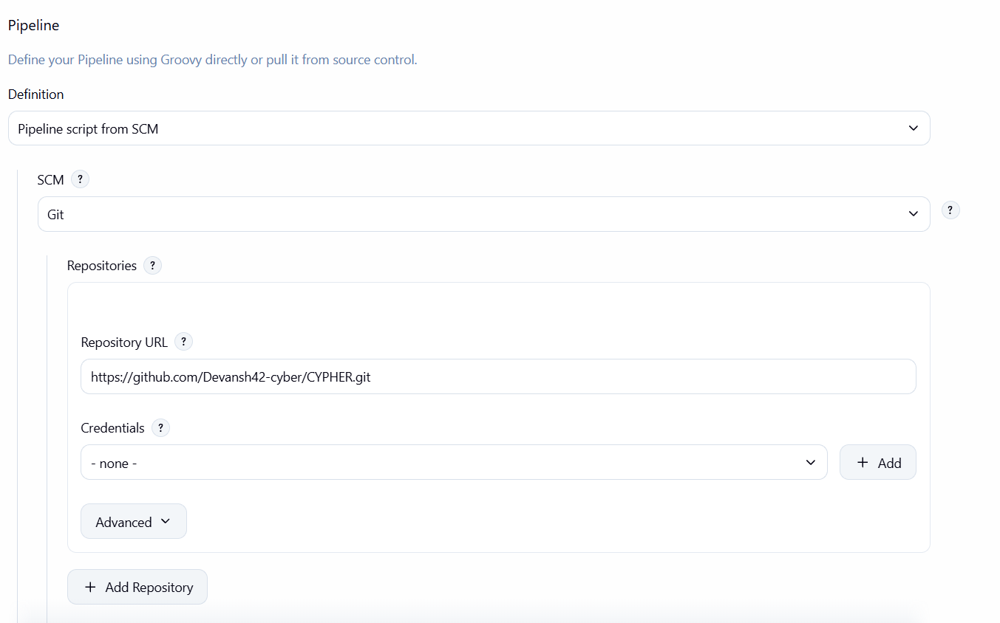
*Figure: Pipeline script from SCM: GitHub repository*

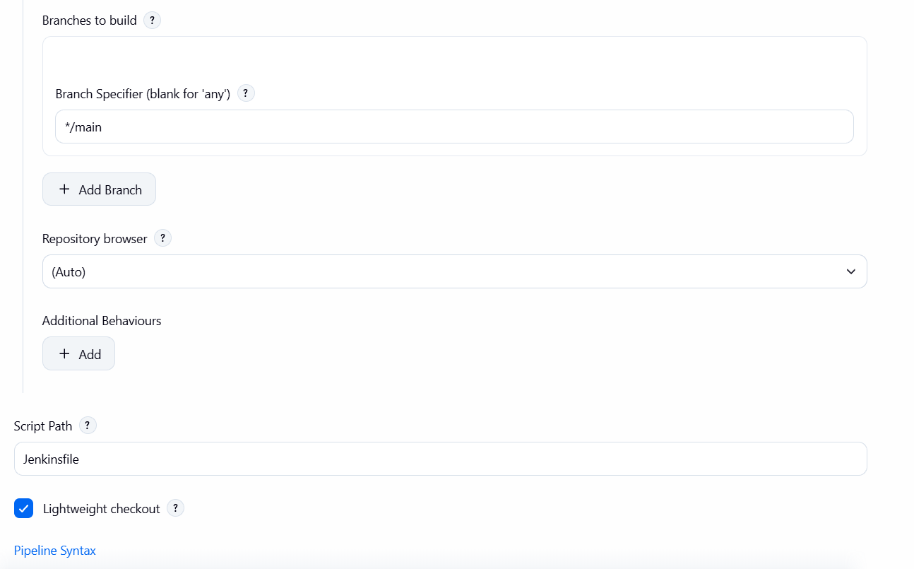
*Figure: Branch */main and Jenkinsfile script path*

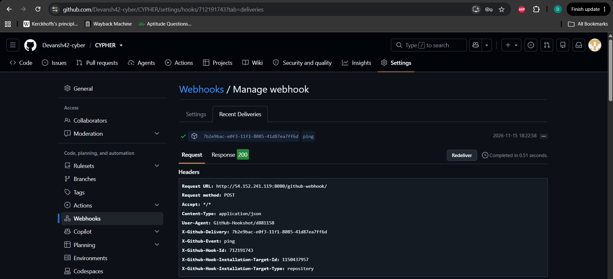
*Figure: GitHub webhook delivered to Jenkins (HTTP 200)*

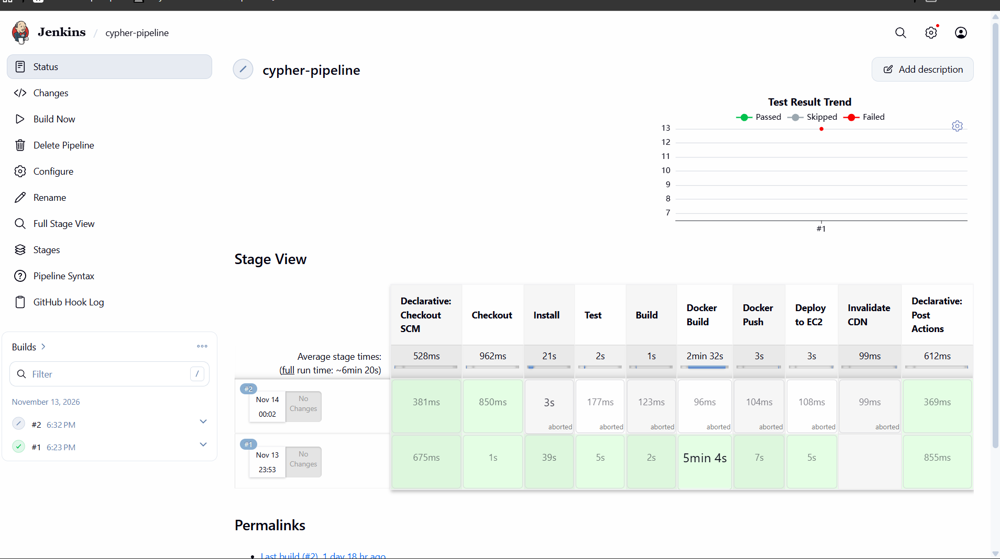
*Figure: First successful pipeline run (build #1)*

## 6. AWS Infrastructure

| Resource | Configuration |
|---|---|
| EC2 | t3.small, Ubuntu 24.04, region `us-east-1`, Elastic IP `54.152.241.119`, 20 GB gp3, 2 GB swap |
| Security group | 22 (SSH, my IP only), 80 (HTTP, app/CloudFront origin), 8080 (Jenkins + GitHub webhook) |
| IAM role | `cypher-ec2-role` with `deploy/aws/iam-policy.json` (ECR push/pull for `cypher`, CloudFront invalidation) |
| ECR | Repository `cypher`, scan on push, lifecycle policy `deploy/aws/ecr-lifecycle-policy.json` |
| Restart on reboot | Docker service enabled at boot + container `--restart unless-stopped` |
| Health check | `GET /health` → `{"status":"ok","model_loaded":true,"version":...}`; Docker HEALTHCHECK + deploy script check |

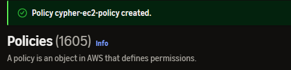
*Figure: IAM policy cypher-ec2-policy created*

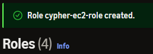
*Figure: IAM role cypher-ec2-role created*

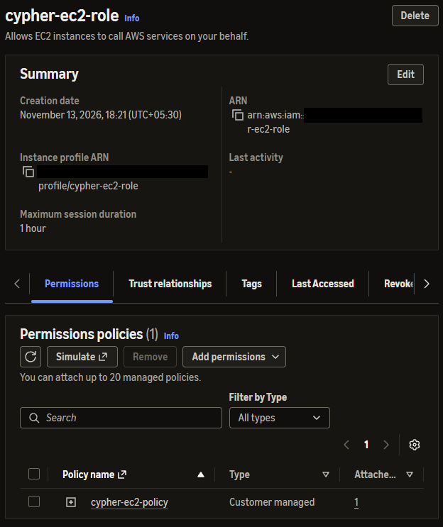
*Figure: Role with policy attached (account ID redacted)*

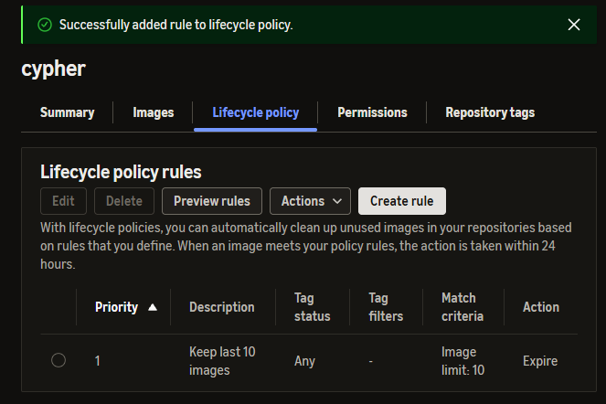
*Figure: ECR repository cypher with lifecycle rule (keep last 10 images)*

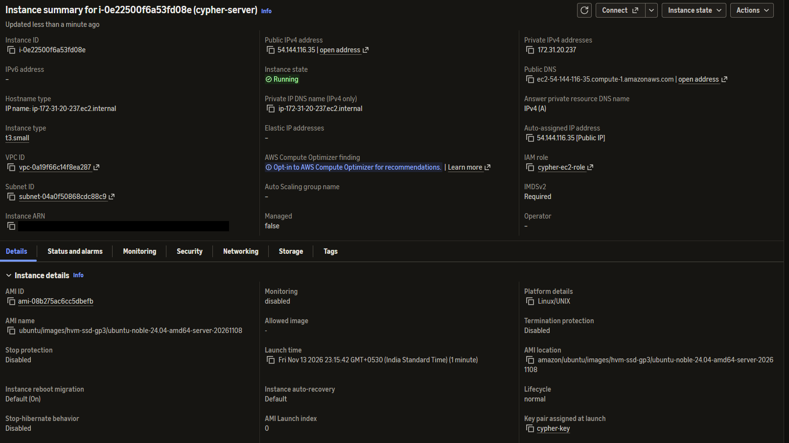
*Figure: EC2 instance cypher-server: t3.small, running, IAM role attached (before the Elastic IP was associated)*

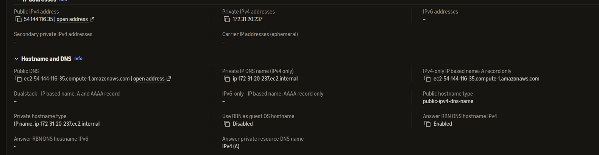
*Figure: Instance networking: public IP and DNS*

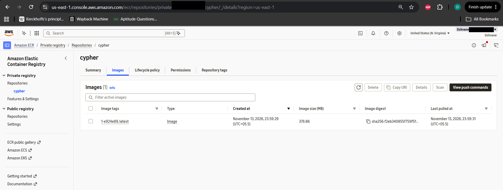
*Figure: First image pushed to ECR by Jenkins*

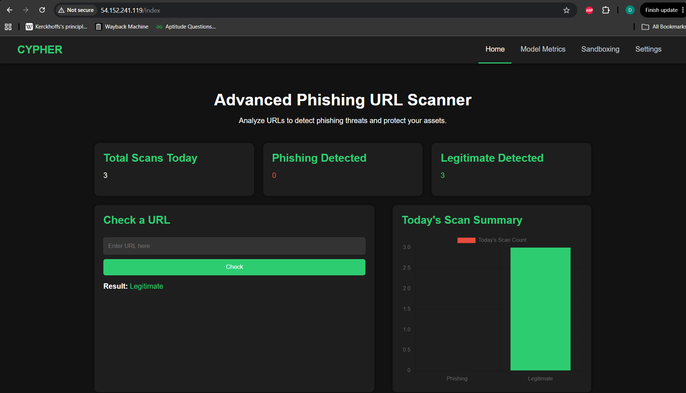
*Figure: Application deployed on EC2 and serving requests*

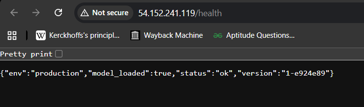
*Figure: Health check endpoint on EC2*

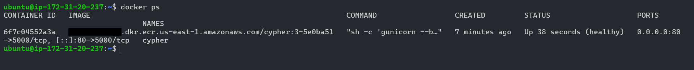
*Figure: After an EC2 reboot the container came back up automatically and healthy*

## 7. CloudFront Configuration

| Setting | Value |
|---|---|
| Origin | EC2 public DNS `ec2-x-x-x-x.<region>.compute.amazonaws.com`, HTTP only, port 80 |
| Viewer protocol | Redirect HTTP → HTTPS (default `*.cloudfront.net` certificate) |
| Default behavior `*` | Managed policy **CachingDisabled**, origin request policy **AllViewerExceptHostHeader**, all HTTP methods allowed (so `POST /check_url_api` works) |
| Behavior `/static/*` | Managed policy **UseOriginCacheControlHeaders-QueryStrings** — Flask sends `Cache-Control: max-age=31536000` and the cache key includes `?v=<version>` |

**How updates reach users:**
1. **Versioned assets:** templates reference `/static/css/index.css?v=<APP_VERSION>`. Each deploy has a new version, so the URL changes and CloudFront fetches the new file — no stale CSS.
2. **Dynamic pages and API** are never cached, so a new deploy is visible immediately.
3. **Invalidation:** the pipeline also creates a `/*` invalidation as a safety net.

> Production note: for end-to-end encryption, put the origin behind a domain with a TLS certificate (e.g. an ALB with ACM, or Nginx + Let's Encrypt on EC2) and set the origin protocol to HTTPS only.

**Status:** CloudFront distribution creation is blocked by AWS for this (new) account until AWS Support verifies it. A support case (#179474811500199) was raised on 15 Nov 2026. The configuration above is ready to apply as soon as the account is verified; the Jenkinsfile already contains the invalidation stage (enabled by setting `CLOUDFRONT_DISTRIBUTION_ID`).

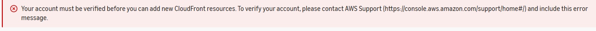
*Figure: AWS error when creating the distribution: account verification required*

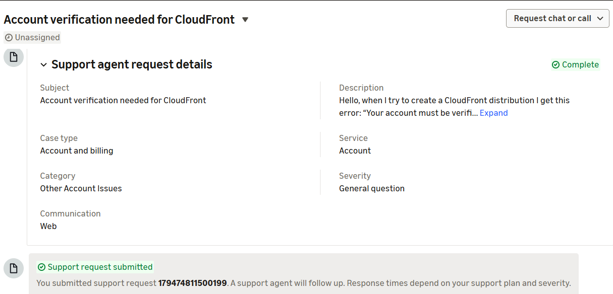
*Figure: AWS Support case #179474811500199 raised*

## 8. Deployment & Rollback Procedure

**Normal deployment (automatic):** merge into `main` → webhook → Jenkins → tests → image → ECR → `deploy.sh` → health check → live.

**Automatic rollback:** `deploy.sh` keeps the old container (`cypher-previous`) until the new one passes its health check. If the new version is unhealthy within ~60 s, it is removed and the previous container is restarted. The Jenkins build is marked failed.

**Manual rollback:**
```bash
ssh ubuntu@<EC2-DNS>
sudo -u jenkins bash /var/lib/jenkins/workspace/<job>/deploy/rollback.sh             # previous version
sudo -u jenkins bash /var/lib/jenkins/workspace/<job>/deploy/rollback.sh <image:tag> # any tag in ECR
```
Alternatively, revert the commit on `main` and push — the pipeline redeploys the old code.

## 9. End-to-End Demonstration

**Change made:** dashboard heading changed from *"Advanced Phishing URL Scanner"* to *"CYPHER v2 – AI Phishing URL Scanner"* (plus a Dockerfile fix), on branch `feature/ui-update`.

| Step | Evidence |
|---|---|
| 1–3. Change committed, PR into `develop`, then PR #7 into `main` | PR #7 |
| 4. GitHub webhook triggered Jenkins automatically | Build #3 "Started by GitHub push" |
| 5. Tests ran and a new Docker image was built | Build #3 stage view |
| 6. Image pushed to ECR | Tag `3-5e0ba51` |
| 7. Redeployed to EC2 automatically | Footer shows `Version 3-5e0ba51 · production` |

No files were built or copied to the server manually.

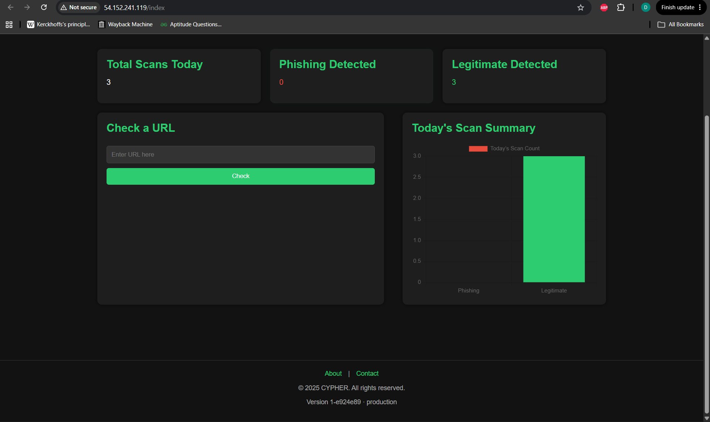
*Figure: Before: original heading, version 1-e924e89*

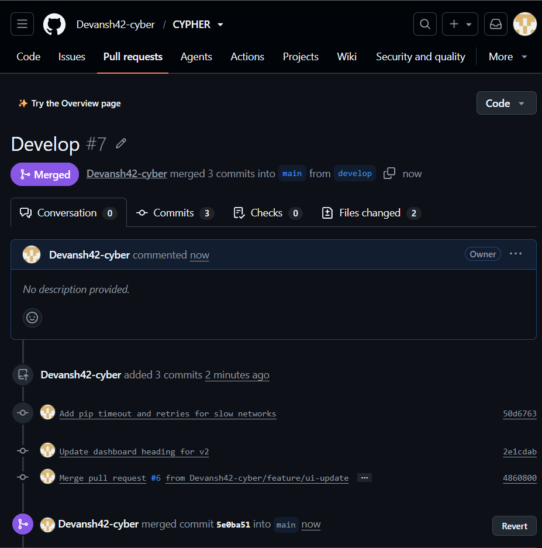
*Figure: PR #7 merged into main (heading change + Dockerfile fix)*

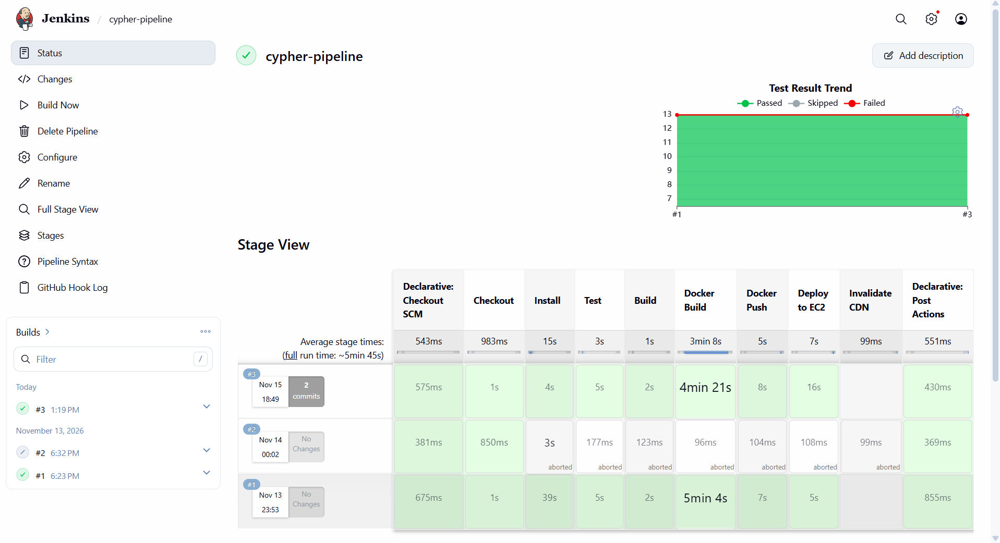
*Figure: Build #3 triggered automatically by the push, all stages green*

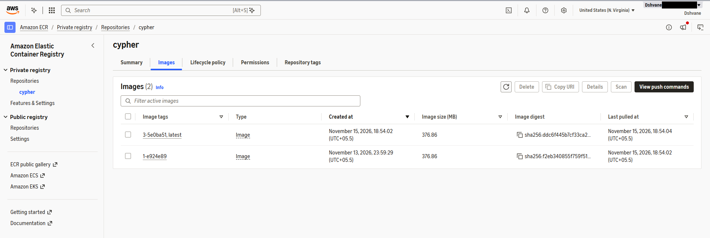
*Figure: New image 3-5e0ba51 pushed to ECR*

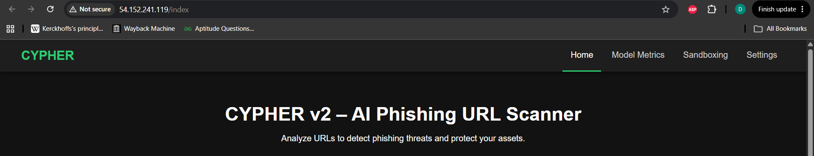
*Figure: After: new heading live on EC2*

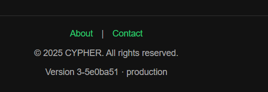
*Figure: Footer shows the new version 3-5e0ba51*

## 10. Challenges & Solutions

| Challenge | Solution |
|---|---|
| App folder name contained spaces, which breaks Docker `COPY` and shell scripts | Renamed to `cypher/` |
| Model path was relative to the working directory | Path now resolved from the app file; overridable with `MODEL_PATH` |
| `tldextract` downloads the suffix list at runtime (fails offline / in CI) | Uses the bundled snapshot (`suffix_list_urls=()`) |
| No automated tests existed | Added a pytest suite (13 tests) that gates the pipeline |
| Jenkins + Docker builds exhaust memory on small instances | 2 GB swap file + t3.small or larger |
| Dashboard stats are kept in memory | Gunicorn runs 1 worker with 4 threads so the counts stay consistent |
| CSS cached by CloudFront after a deploy | Versioned asset URLs (`?v=`) + query string in cache key + invalidation |
| New AWS account could only launch EC2 in 3 regions (Mumbai locked) | Moved all resources to us-east-1 and updated the region in the Jenkinsfile and deploy script via a pull request |
| CloudFront blocked: "account must be verified" | Raised AWS Support case #179474811500199; CloudFront configuration documented and ready to apply |
| SSH timed out from a mobile hotspot (IP kept changing, so the "My IP" rule no longer matched) | Allowed SSH from anywhere; access still requires the private key |
| Public IP would change on every stop/start, breaking the webhook | Allocated an Elastic IP (54.152.241.119) |
| `pip install` timed out inside `docker build` on a slow network | Added `--default-timeout=120 --retries 10` to the Dockerfile |
| Docker CLI error "cannot find dockerDesktopLinuxEngine" | Docker Desktop engine was not running; started it |
| Windows changed the executable bit on shell scripts, causing git conflicts | Set `git config core.filemode false`; scripts are invoked with `bash` |
| A build was aborted when the instance was stopped mid-build | Rebuilt; pipeline is idempotent and uses unique image tags |
