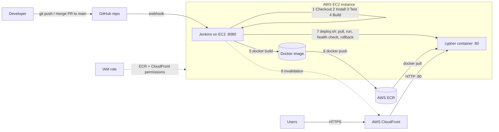

# CYPHER — DevOps Documentation

> Screenshots go in `docs/screenshots/`. Replace each `TODO` marker with your own image/values before submitting.

## 1. Project Overview & Technology Stack

**CYPHER** is a Flask web application that classifies URLs as *phishing* or *legitimate* using lexical feature extraction and a Random Forest model, with a live statistics dashboard.

| Layer | Technology |
|---|---|
| Application | Python 3.12, Flask, scikit-learn, tldextract, Chart.js |
| App server | Gunicorn (inside Docker) |
| Version control | Git, GitHub (`main`, `develop`, feature branches + pull requests) |
| Containerization | Docker (`python:3.12-slim`, non-root user, built-in HEALTHCHECK) |
| CI/CD | Jenkins (declarative `Jenkinsfile`, GitHub webhook trigger) |
| Registry | AWS ECR (`cypher` repository, lifecycle policy keeps 10 images) |
| Hosting | AWS EC2 (Ubuntu 24.04) running Jenkins + the app container |
| CDN / HTTPS | AWS CloudFront (`https://dxxxxxxxx.cloudfront.net`) |
| Access control | IAM instance role (no access keys stored), Jenkins credentials store |

**Live URL:** `TODO: https://dxxxxxxxxxxxx.cloudfront.net`

## 2. DevOps Architecture



`TODO: also export this as an image (e.g. draw.io) into docs/screenshots/architecture.png if your evaluator can't render Mermaid.`

## 3. Git Repository Structure & Workflow

```
CYPHER/
├── cypher/            # Flask app, model, templates, static assets, tests
├── deploy/            # setup-ec2.sh, deploy.sh, rollback.sh, aws/ policies
├── Dockerfile  .dockerignore  .gitignore  .env.example
├── Jenkinsfile
├── README.md  DEVOPS.md
```

- **Branches:** `main` (production, deployed by Jenkins), `develop` (integration), `feature/*` (individual changes).
- **Flow:** `feature/x` → PR into `develop` → PR `develop` → `main` → webhook → pipeline → deploy.
- **Secrets:** `.gitignore` blocks `.env`, keys (`*.pem`, `*.key`, `id_rsa*`), AWS credentials and local databases. A local SQLite file (`instance/app.db`) and `__pycache__` were removed from tracking. Runtime configuration comes from environment variables (see `.env.example`).

`TODO screenshots: repo home, branches page, a merged pull request, commit history`

## 4. Docker

**Dockerfile highlights:** slim Python base image; dependencies installed in a separate cached layer; build-time check that the ML model loads; runs as non-root `appuser`; exposes port 5000; `HEALTHCHECK` calls `/health`; served by Gunicorn.

```bash
# Build
docker build -t cypher .

# Run (configuration through environment variables)
docker run -d --name cypher -p 5000:5000 \
  -e APP_ENV=development -e APP_VERSION=local cypher

# Verify
curl http://localhost:5000/health
docker ps            # STATUS shows (healthy)
```

`TODO screenshots: docker build output, docker images, docker ps (healthy), app in browser at localhost:5000`

## 5. Jenkins Pipeline

Job type: **Pipeline from SCM**, branch `*/main`, trigger **GitHub hook trigger for GITScm polling**. Webhook: `http://<EC2-DNS>:8080/github-webhook/`.

| Stage | What it does |
|---|---|
| Checkout | Pulls the commit that triggered the build; image tag = `<build#>-<git sha>` |
| Install | Creates a virtualenv and installs `requirements-dev.txt` |
| Test | Runs 13 pytest tests (features, pages, API, health); JUnit report published; **any failure stops the pipeline** |
| Build | Byte-compiles the app and verifies the model loads |
| Docker Build | `docker build -t cypher:<tag> .` |
| Docker Push | Logs in to ECR via the instance IAM role and pushes `<tag>` and `latest` |
| Deploy to EC2 | `deploy/deploy.sh` pulls the image, starts it with `--restart unless-stopped`, health-checks `/health`, rolls back automatically on failure |
| Invalidate CDN | Creates a CloudFront invalidation for `/*` (when the distribution ID is set) |

**Credentials:** AWS access uses the EC2 **IAM role** (`deploy/aws/iam-policy.json`) — no access keys exist in Jenkins or Git. The AWS account ID is stored as a Jenkins *Secret text* credential (`aws-account-id`).

`TODO screenshots: pipeline stage view (all green), console output, test results, webhook delivery (GitHub → Settings → Webhooks → Recent deliveries), credentials page (values hidden)`

## 6. AWS Infrastructure

| Resource | Configuration |
|---|---|
| EC2 | `TODO type (t3.small/medium)`, Ubuntu 24.04, region `ap-south-1`, 2 GB swap |
| Security group | 22 (SSH, my IP only), 80 (HTTP, app/CloudFront origin), 8080 (Jenkins + GitHub webhook) |
| IAM role | `cypher-ec2-role` with `deploy/aws/iam-policy.json` (ECR push/pull for `cypher`, CloudFront invalidation) |
| ECR | Repository `cypher`, scan on push, lifecycle policy `deploy/aws/ecr-lifecycle-policy.json` |
| Restart on reboot | Docker service enabled at boot + container `--restart unless-stopped` |
| Health check | `GET /health` → `{"status":"ok","model_loaded":true,"version":...}`; Docker HEALTHCHECK + deploy script check |

`TODO screenshots: EC2 instance details, security group rules, IAM role, ECR repository with image tags (redact account ID)`

## 7. CloudFront Configuration

| Setting | Value |
|---|---|
| Origin | EC2 public DNS `ec2-x-x-x-x.<region>.compute.amazonaws.com`, HTTP only, port 80 |
| Viewer protocol | Redirect HTTP → HTTPS (default `*.cloudfront.net` certificate) |
| Default behavior `*` | Managed policy **CachingDisabled**, origin request policy **AllViewerExceptHostHeader**, all HTTP methods allowed (so `POST /check_url_api` works) |
| Behavior `/static/*` | Managed policy **UseOriginCacheControlHeaders-QueryStrings** — Flask sends `Cache-Control: max-age=31536000` and the cache key includes `?v=<version>` |

**How updates reach users:**
1. **Versioned assets:** templates reference `/static/css/index.css?v=<APP_VERSION>`. Each deploy has a new version, so the URL changes and CloudFront fetches the new file — no stale CSS.
2. **Dynamic pages and API** are never cached, so a new deploy is visible immediately.
3. **Invalidation:** the pipeline also creates a `/*` invalidation as a safety net.

> Production note: for end-to-end encryption, put the origin behind a domain with a TLS certificate (e.g. an ALB with ACM, or Nginx + Let's Encrypt on EC2) and set the origin protocol to HTTPS only.

`TODO screenshots: distribution general settings, origin, behaviors list, an invalidation, the app over https://...cloudfront.net`

## 8. Deployment & Rollback Procedure

**Normal deployment (automatic):** merge into `main` → webhook → Jenkins → tests → image → ECR → `deploy.sh` → health check → live.

**Automatic rollback:** `deploy.sh` keeps the old container (`cypher-previous`) until the new one passes its health check. If the new version is unhealthy within ~60 s, it is removed and the previous container is restarted. The Jenkins build is marked failed.

**Manual rollback:**
```bash
ssh ubuntu@<EC2-DNS>
sudo -u jenkins bash /var/lib/jenkins/workspace/<job>/deploy/rollback.sh             # previous version
sudo -u jenkins bash /var/lib/jenkins/workspace/<job>/deploy/rollback.sh <image:tag> # any tag in ECR
```
Alternatively, revert the commit on `main` and push — the pipeline redeploys the old code.

## 9. End-to-End Demonstration

`TODO: describe the change you made (e.g. footer text / heading colour), with before/after screenshots, the triggered build number, the new image tag in ECR, and the CloudFront page showing the new version in the footer.`

## 10. Challenges & Solutions

| Challenge | Solution |
|---|---|
| App folder name contained spaces, which breaks Docker `COPY` and shell scripts | Renamed to `cypher/` |
| Model path was relative to the working directory | Path now resolved from the app file; overridable with `MODEL_PATH` |
| `tldextract` downloads the suffix list at runtime (fails offline / in CI) | Uses the bundled snapshot (`suffix_list_urls=()`) |
| No automated tests existed | Added a pytest suite (13 tests) that gates the pipeline |
| Jenkins + Docker builds exhaust memory on small instances | 2 GB swap file + t3.small or larger |
| Dashboard stats are kept in memory | Gunicorn runs 1 worker with 4 threads so the counts stay consistent |
| CSS cached by CloudFront after a deploy | Versioned asset URLs (`?v=`) + query string in cache key + invalidation |
| `TODO: add the real problems you hit` | |
